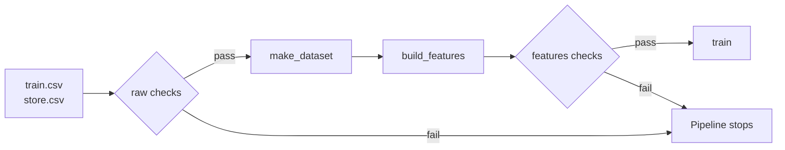

# Data Validation with Great Expectations

The pipeline checks its data before it uses it. This page explains what is checked, where the rules live, and what happens when a check fails.

______________________________________________________________________

## What is Great Expectations?

[Great Expectations](https://greatexpectations.io/) (GX) is an open-source Python library for data validation. You write **expectations**, which are rules your data should meet, such as "Sales is never negative". GX checks a dataset against them and reports which rules passed and which failed.

**Think of it as unit tests for your data.** Without validation, bad data flows silently into training and shows up weeks later as a worse model. With it, the pipeline stops at the step where the problem entered and says what is wrong.

This project uses Great Expectations 1.x.

______________________________________________________________________

## Where the pipeline checks its data



| Suite | Data | Checked when | What it protects against |
|---|---|---|---|
| `raw_store` | `data/raw/store.csv` | As data arrives | Missing or extra stores, duplicated stores, unknown store types |
| `raw_train` | `data/raw/train.csv` | As data arrives | Broken exports, negative sales, sales for unknown stores, bad dates |
| `features` | `data/processed/train_features.parquet` | Just before training | A model feature that is missing or has blank values |

Checking at the start catches problems in the source data. Checking just before training catches problems the pipeline's own code introduced.

______________________________________________________________________

## Running validation

```bash
python src/data/validate_data.py --stage raw        # the two raw files
python src/data/validate_data.py --stage features   # the feature table
python src/data/validate_data.py                    # both
```

When every rule passes:

```
raw_store  PASSED  (8 of 8 rules passed)
raw_train  PASSED  (14 of 14 rules passed)
features   PASSED  (39 of 39 rules passed)

Data Docs: gx/uncommitted/data_docs/local_site/index.html

✓ All data checks passed.
```

When a rule fails, the script lists each failed rule, a few of the rows that broke it, and the reason the rule exists. It then **exits with code 1**, which stops the pipeline (DVC, the shell scripts, and CI all treat a non-zero exit as a failure):

```
raw_store  PASSED  (8 of 8 rules passed)
raw_train  FAILED  (11 of 14 rules passed)
  ✗ expect_column_values_to_be_in_set on Store: 1 row failed, for example [999]
      Rule: Every sale belongs to a store listed in store.csv.
  ✗ expect_column_values_to_match_strftime_format on Date: 1 row failed, for example ['31/07/2015']
      Rule: Dates are written as YYYY-MM-DD, such as 2015-07-31.
  ✗ expect_column_values_to_be_between on Sales: 3 rows failed, for example [-100, -100, -100]
      Rule: Daily sales are never negative and no store sells over 50,000 a day.

Data Docs: gx/uncommitted/data_docs/local_site/index.html

✗ Data checks failed. Fix the data before running the next pipeline step.
```

### Data Docs

Every run also updates **Data Docs**, a set of web pages that show each suite's rules and the result of every past run. Open `gx/uncommitted/data_docs/local_site/index.html` in a browser. In Codespaces or Colab, download the `gx/uncommitted/data_docs/local_site/` folder and open `index.html` locally.

______________________________________________________________________

## Where the rules live

All the rules are in one file, [`src/data/expectations.py`](https://github.com/bradleyboehmke/uc-bana-7075-reference-system/blob/main/src/data/expectations.py). Each suite is a function that adds rules one at a time:

```python
import great_expectations as gx
import great_expectations.expectations as gxe

def raw_store_suite():
    suite = gx.ExpectationSuite(name="raw_store")

    suite.add_expectation(
        gxe.ExpectColumnValuesToBeUnique(
            column="Store",
            notes="Each store appears once, so joining it to sales can't duplicate rows.",
        )
    )
    ...
    return suite
```

Every rule has a `notes` entry saying in plain language why it exists. The note is printed when the rule fails and shown in Data Docs.

### The current rules

**`raw_store`** (store.csv)

- The columns match the expected list, in order
- Exactly 100 rows (this system uses 100 of Rossmann's 1,115 stores)
- Store is filled in and unique
- StoreType is a–d; Assortment is a–c; Promo2 is 0 or 1
- CompetitionDistance is not negative (blank is allowed)

**`raw_train`** (train.csv)

- The columns match the expected list, in order
- Between 50,000 and 150,000 rows (the sample has 91,992)
- Store, Date, and Sales are filled in
- Every Store appears in store.csv
- Dates are written as YYYY-MM-DD
- Sales are between 0 and 50,000; Customers are not negative
- DayOfWeek is 1–7; Open, Promo, and SchoolHoliday are 0 or 1; StateHoliday is 0, a, b, or c

**`features`** (train_features.parquet)

- The same row-count range as train.csv (building features never drops rows)
- Sales and all 12 model features listed in `config/params.yaml` are present and filled in
- Sales are not negative; Year is 2013–2015; Month is 1–12; Week is 1–53
- CompetitionDistance is between 0 and 100,000 (missing distances are filled with 100,000)
- Yes/no flags are 0 or 1, and the categorical features take only the values seen in the raw data

The features suite reads the model's feature list from `config/params.yaml`, so adding a feature there automatically adds checks that it exists and has no blanks.

### Adding or changing a rule

1. Find the suite in `src/data/expectations.py`.
2. Add one `suite.add_expectation(...)` call. Pick the expectation from the [Expectation Gallery](https://greatexpectations.io/expectations/); the class name is the gallery name in CamelCase (for example, `expect_column_values_to_be_between` is `gxe.ExpectColumnValuesToBeBetween`).
3. Give it `notes="..."` that explain the business reason.
4. Run `python src/data/validate_data.py` to confirm the rule passes on the current data, and `pytest tests/test_data_validation.py` to confirm the tests still pass.

Start with a few rules that catch real problems rather than many that restate the data. A rule that fails on good data trains people to ignore failures.

______________________________________________________________________

## How the code works

`src/data/validate_data.py` follows Great Expectations' standard pattern:

1. **Data context**: the GX project folder, `gx/`. The script creates it on the first run. It is not committed to Git, because everything in it is generated: GX's own copies of the suites, the validation results, and Data Docs.
2. **Data source and batch definition**: tell GX the data is a pandas dataframe.
3. **Validation definition**: pairs the data with a suite.
4. **Checkpoint**: runs the validation, saves the result, and then runs its actions. Here the one action updates Data Docs.

```python
from data.validate_data import get_context, run_checkpoint
from data.expectations import raw_store_suite
import pandas as pd

context = get_context()
result = run_checkpoint(context, pd.read_csv("data/raw/store.csv"), raw_store_suite())
result.success   # True when every rule passed
```

______________________________________________________________________

## When validation fails

1. **Read the failure.** The message names the rule, the column, and example values.
2. **Decide whether the data or the rule is wrong.**
    - The data is wrong (a broken export, a bad join, a bug in feature code): fix the data or the code, then rerun.
    - The rule is out of date (the business changed, for example new stores opened): update the rule in `expectations.py`, explain why in its note, and commit the change so the reason is recorded.
3. **Never skip validation to get the pipeline through.** If the data is bad, the model trained on it will be too.

______________________________________________________________________

## Resources

- [Great Expectations documentation](https://docs.greatexpectations.io/)
- [Expectation Gallery](https://greatexpectations.io/expectations/): the full list of built-in expectations
