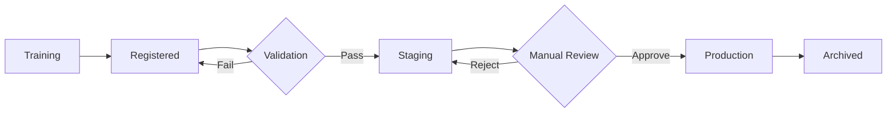

# ModelOps Overview

## What is ModelOps?

ModelOps (Model Operations) is the practice of managing a machine learning model's lifecycle: training it reproducibly, versioning it, deciding when it is good enough to serve, and replacing it safely. This project uses MLflow for tracking and versioning.

## Key Components

### 1. Training (`src/models/train.py`)

One LightGBM model with fixed hyperparameters from `config/params.yaml`, trained on 12 features. See [Model Training](training.md).

- Loads `data/processed/train_features.parquet`
- Holds out the last 6 weeks for evaluation
- Logs parameters, metrics, and the data version to MLflow
- Registers the model as `rossmann-model`

### 2. Model Registry (MLflow)

Centralized model versioning with stage-based promotion:

- **Registration:** each training run registers a new version
- **Staging:** a version is promoted to Staging after passing the RMSPE threshold (`validation.max_rmspe`)
- **Production:** a person promotes Staging to Production (human-in-the-loop safety)
- **Archival:** the previous Production version is archived automatically
- **Lineage:** each version links to its training run, parameters, and data version

### 3. Production code (`src/models/`)

- **`train.py`:** trains, evaluates, logs, and registers the model
- **`validate_model.py`:** scores a registered version on the holdout and promotes it to Staging if it passes
- **`predict.py`:** loads a model by stage and generates batch predictions
- **`model_registry.py`:** helpers to register, promote, load, and describe models
- **`explain.py`:** SHAP values for individual predictions (code only)

### 4. Automated retraining (`scripts/retrain_pipeline.sh`)

1. Validate new raw data with Great Expectations
2. Build features
3. Train with `python -m src.models.train`
4. Validate and promote to Staging with `validate_model.py`
5. A person reviews Staging in the MLflow UI before promoting to Production
6. Optionally test inference with the Production model

## Quick Start

```bash
# Train and register (a few seconds)
python -m src.models.train

# Promote to Staging if RMSPE <= validation.max_rmspe
python src/models/validate_model.py

# Promote Staging to Production
python src/models/validate_model.py --promote-to-production

# Batch predictions with the Production model
python src/models/predict.py --stage Production

# Browse runs and the registry
mlflow ui   # http://localhost:5000
```

## Model Lifecycle



## Documentation Structure

- **Overview** (this page)
- **[Experiment Tracking](tracking.md)** - MLflow tracking guide
- **[Model Training](training.md)** - The model, its features, and the training pipeline
- **[Model Registry](registry.md)** - Model versioning and lifecycle

See [DataOps Documentation](../dataops/overview.md) for the data pipeline.
