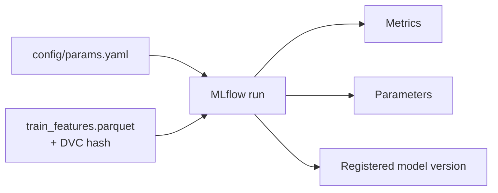

# Experiment Tracking

## Why track experiments?

Every training run makes choices: which data, which features, which hyperparameters. Without a record, nobody can say later why one model was better than another or reproduce it. MLflow records each run so it can be compared, explained, and traced back to its data.

## What each training run logs

`python -m src.models.train` opens one MLflow run named `train_lightgbm` in the `rossmann-forecasting` experiment and logs:

| What | Examples |
|---|---|
| **Parameters** | `num_leaves`, `learning_rate`, `num_boost_round`, `seed`, `features`, `n_features`, `train_rows`, `holdout_rows` |
| **Data version** | `git_commit_hash`, `dvc_file_hash`, `data_file_path` |
| **Metrics** | `rmspe`, `rmse`, `mae` on the 6-week holdout, and `train_seconds` |
| **Model** | The LightGBM model, registered as a new version of `rossmann-model` |



## Viewing runs

```bash
mlflow ui
```

Open http://localhost:5000 to:

- **Compare runs** side by side (for example, before and after changing a hyperparameter)
- **Sort and filter** by metrics, such as `metrics.rmspe < 0.2`
- **Open a run** to see its parameters, metrics, and model artifact
- **Follow a model version** in the registry back to the run that produced it

## Running an experiment

Because the hyperparameters are fixed in `config/params.yaml`, an experiment is a deliberate change:

1. Edit a value under `model.lightgbm` (for example, `num_leaves: 63`), or the feature list under `features.model_features`.
2. Run `python -m src.models.train`.
3. Compare the new run with the previous one in the MLflow UI.
4. Keep the change only if the holdout RMSPE improves for a reason you can explain.

## Configuration

Tracking settings live in `config/params.yaml` under `mlflow` (tracking URI, experiment name, and registered model name). `src/utils/mlflow_utils.py` reads them in `setup_mlflow()`.

## Best practices

1. **Change one thing at a time** so a difference in metrics has one explanation.
2. **Always log the data version**; the training script does this for you.
3. **Compare on the same holdout**; `training.holdout_days` keeps it fixed.
4. **Record why**: add a note to the run in the MLflow UI when you keep or discard a change.
