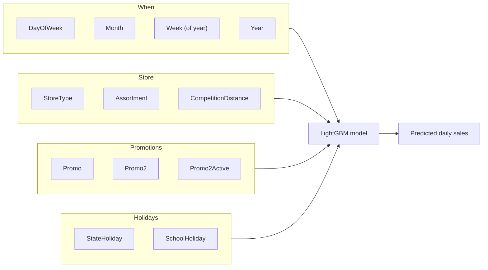
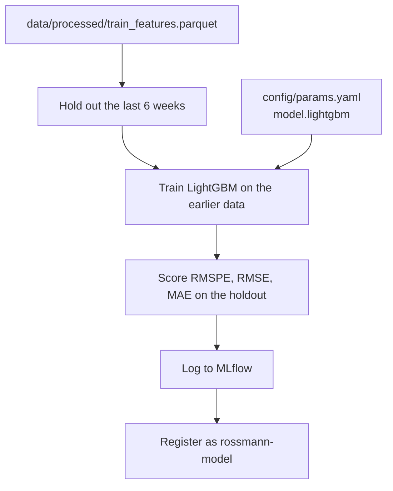

# Model Training

The system trains **one LightGBM model with fixed hyperparameters**. There is no ensemble and no hyperparameter search: the subject of this system is everything around the model, so the model is kept as simple as it can be while still forecasting well.

```bash
python -m src.models.train
```

Training finishes in a few seconds on a laptop.

## The features

The model uses 12 features, all known in advance for any future date. None of them is computed from past sales, so the API builds exactly the same features from a request that training builds from history.



| Group | Feature | Why it matters |
|---|---|---|
| When | `DayOfWeek` | Shoppers buy more on some weekdays than others |
| | `Month` | Seasonal demand, such as December holiday shopping |
| | `Week` | Holiday run-ups like Easter that move between months |
| | `Year` | Overall growth or decline from year to year |
| Store | `StoreType` | Store format (a–d) sets the baseline sales level |
| | `Assortment` | Wider product ranges draw bigger baskets |
| | `CompetitionDistance` | A nearby competitor takes customers |
| Promotions | `Promo` | A promotion that day lifts sales |
| | `Promo2` | The store takes part in the ongoing coupon program |
| | `Promo2Active` | The coupon program is running this month |
| Holidays | `StateHoliday` | Public holidays close stores or change shopping |
| | `SchoolHoliday` | Families shop differently when schools are out |

The list lives in `config/params.yaml` under `features.model_features`. Training, validation, batch prediction, and the API all read it from there.

## Training workflow



1. **Load features** from `data/processed/train_features.parquet`, produced by `python -m src.features.build_features`.
2. **Split** off the last 42 days (`training.holdout_days`) as a holdout that simulates the next six weeks.
3. **Train** on open-store days only (closed stores sell nothing), using the fixed hyperparameters in `model.lightgbm`.
4. **Evaluate** on the holdout. RMSPE (root mean squared percentage error) is the main metric.
5. **Log** the hyperparameters, feature list, row counts, metrics, training time, and data version to MLflow.
6. **Register** the model in the MLflow Model Registry under `mlflow.model_name` (`rossmann-model`).

## Hyperparameters

```yaml
model:
  lightgbm:
    objective: regression
    num_leaves: 31
    learning_rate: 0.05
    num_boost_round: 500
    seed: 7075
    num_threads: 2
    verbose: -1
```

These values are fixed on purpose. Changing one is a deliberate experiment: edit `config/params.yaml`, retrain, and compare the runs in MLflow.

## After training

```bash
# Check the new version against the RMSPE threshold and promote it to Staging
python src/models/validate_model.py

# Promote the Staging version to Production
python src/models/validate_model.py --promote-to-production
```

The threshold is `validation.max_rmspe` in `config/params.yaml`.

## Explaining predictions (SHAP)

`src/models/explain.py` computes SHAP values: how much each feature pushed a single prediction up or down from the average.

```python
from models.explain import compute_shap_values

shap_df = compute_shap_values(model, X.head(5))
# One column per feature plus base_value; each row sums to the prediction
```
